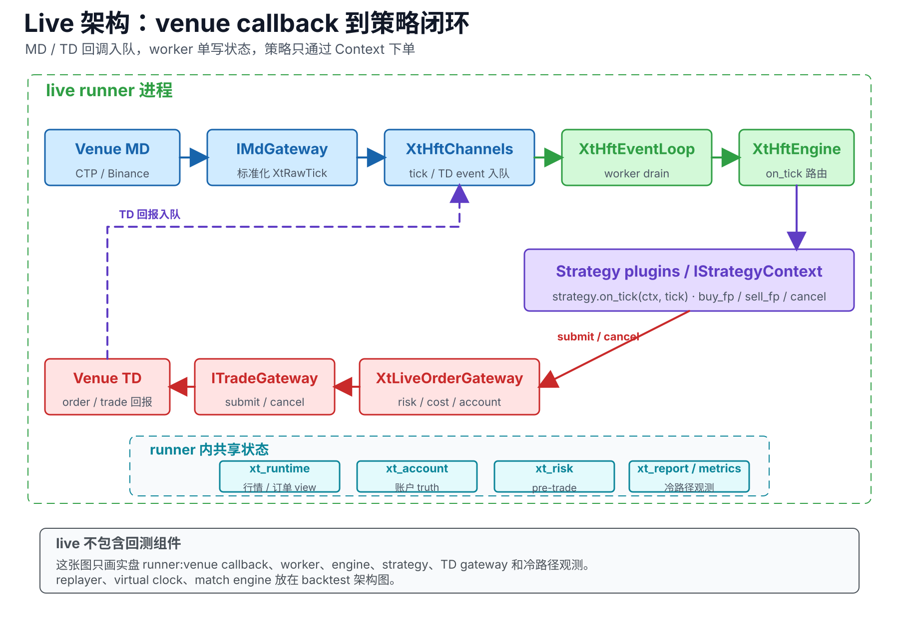
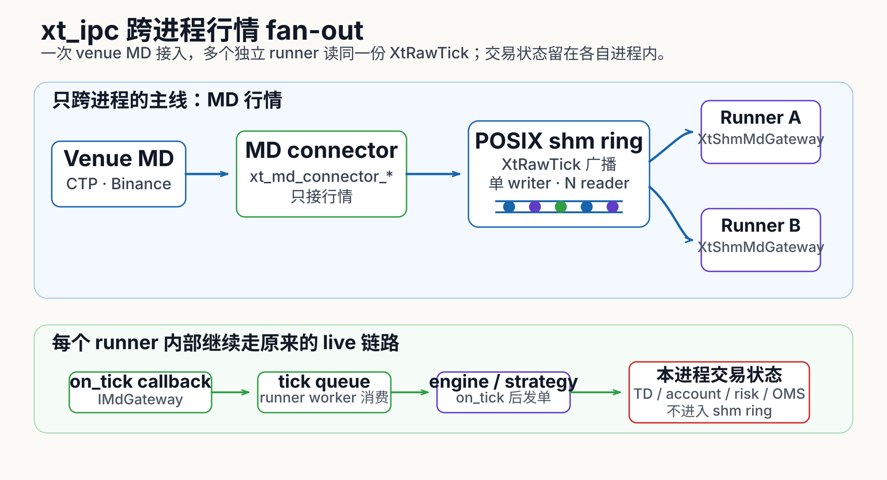
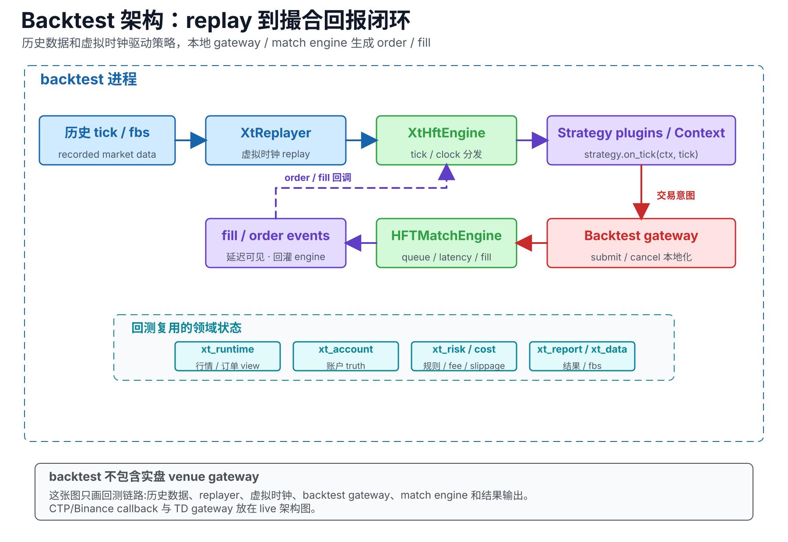
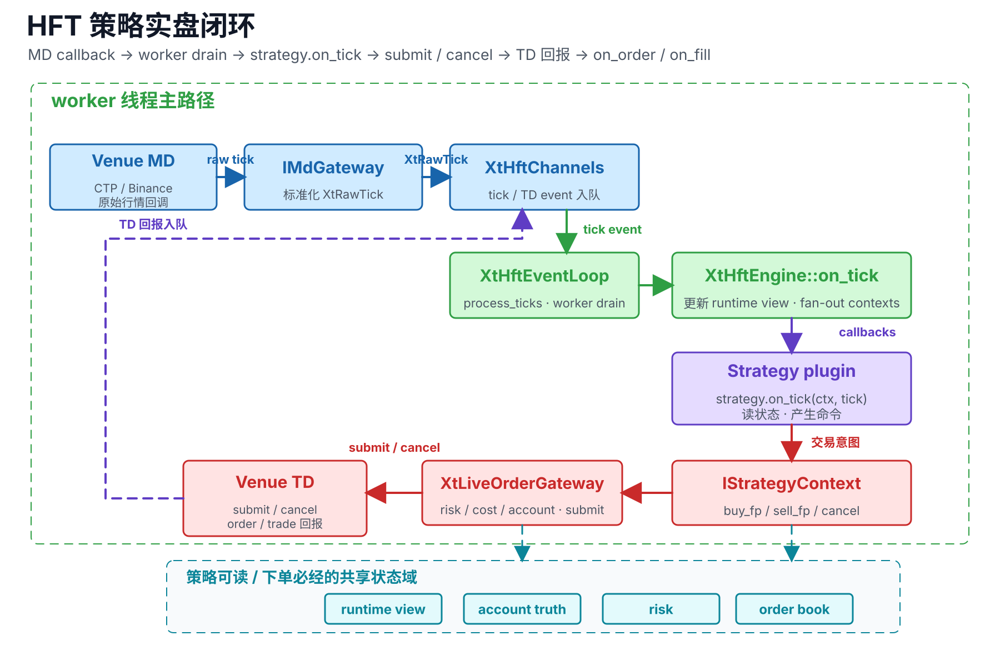
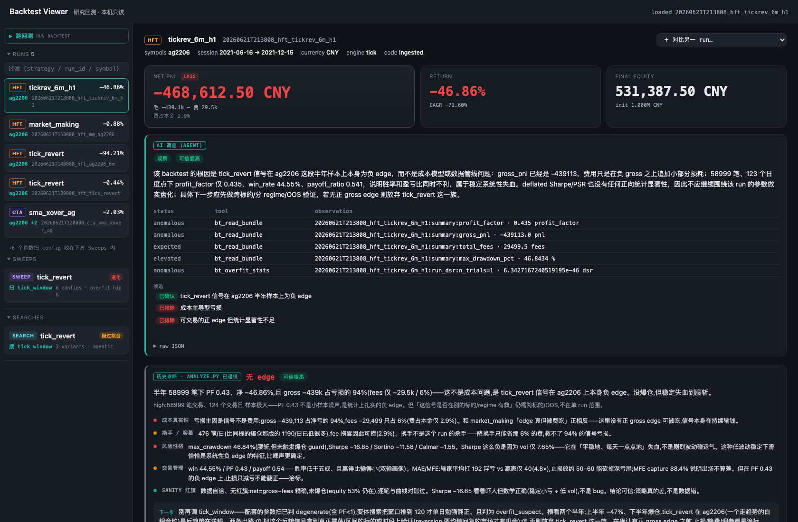

# XyybTrader

<p align="center">
    <a href="https://github.com/cloud-xyyb/XyybTrader-OSS/actions/workflows/build.yml"></a>
    
    
    
</p>

<p align="center">
    <a href="#xyybtrader-的优势">优势</a> ·
    <a href="#怎么写一个-hft-策略">写策略</a> ·
    <a href="#性能与验证">性能</a> ·
    <a href="#生态工具">生态工具</a> ·
    <a href="#构建ubuntu-2204">构建</a> ·
    <a href="#快速开始">快速开始</a> ·
    <a href="#数据">数据</a>
</p>

#### XyybTrader 是什么

XyybTrader 基于 C++17 的高频交易系统，覆盖 tick 级回测、仿真撮合，到实盘交易、风控、录制。

策略以 `.so` 插件的形式接入 `runner`，即插即拔单独编译。回测和实盘维护同一套策略语义，差异只留在 replayer、虚拟时钟、撮合模型等环境边界上。

#### 三类策略引擎

XyybTrader 支持 **HFT**、**CTA**（beta）、**SEL**（beta）三类策略，共用策略接口、账户、风控；本仓目前开源 HFT，CTA 和 SEL 会在后续版本陆续开源。

- **HFT，tick 驱动** —— 行情逐笔喂给策略，单线程事件循环，直连下单接口；适合做市、微观结构和秒级以内的信号。
- **CTA，bar 驱动**（beta）—— tick 实时聚合成 K 线，策略按目标仓位表达意图，引擎负责差量下单和开平拆分；适合分钟到日线级的趋势、均值回归类策略。
- **SEL，定时调仓**（beta）—— 按分钟节拍驱动，策略输出一组目标权重，引擎批量调仓；适合选股和组合再平衡。

#### 架构

实盘：行情和回报从 venue 回调进无锁队列，worker 单线程串行消费，`XtHftEngine` 把 tick、order、fill 分发给策略；下单、账户、风控在同一个进程中完成。



多 runner 组合盘：行情接入由独立的 MD connector 进程完成，tick 写进共享内存 ring，多个组合盘 runner 读同一份行情；下单、账户、风控和安全锁仍留在各自 runner 进程内，交易账户互相隔离，单盘故障不影响其他盘。



回测：历史数据经 replayer 按虚拟时钟回放，backtest gateway 和撮合引擎替代真实交易所。策略、账户、风控的语义与 live 一致。



#### XyybTrader 的优势

* **极低的交易延迟**
    > - 全程单线程事件循环：回调进无锁队列，worker 串行消费，没有锁竞争，延迟稳定
    > - 进程内下单管线亚微秒：策略 `on_tick` 到 venue 提交前的本地全链路（含同步风控）实测约 1 µs，分级数字和口径见下文「性能与验证」

* **回测优化**
    > - 同一份策略在回测和实盘可以获得同样的组件支持
    > - 延迟模型、排队模型可注入，且支持实盘数据分析模拟
    > - 高效回测，单核约 76K ticks/s，全年 1480 万 tick 三分多钟跑完，结果稳定
* **内置风控**
    > - 对每单进行账户级和单策略两层风控，确保异常被及时拦下
    > - watchdog 强平阶梯：策略越界时会自动从告警升级到强制平仓
    > - 支持收盘强平兜底：被动价平仓失败会自动切 IOC 激进平仓，不把仓位带过夜
* **稳定的实盘以及断线恢复**
    > - 重启恢复以交易所回查为基础，反向重建订单簿和账本，不留幽灵仓位、孤儿挂单
    > - 全量录制：行情、委托、回报、成交双轨落盘（JSONL + FlatBuffers），事后整段 replay 对账
* **支持多策略、多组合盘**
    > - 一个 runner 可以挂多个策略，order 和 fill 按策略路由，支持策略粒度的风控管理
    > - 行情通过共享内存分发：connector 连一次交易所，多个组合盘进程读同一份行情，交易账户互相隔离
* **分析工具带 agent（beta）**
    > - 回测查看器内建三层 agent 分析：单次复盘、参数扫过拟合判定、agent 自主调参搜索
    > - 实盘控制台集中管多个 runner，一键暂停、平仓、kill switch

#### 怎么写一个 HFT 策略

策略继承 `XtStrategyBase`，`on_init` 里 `ctx->sub_tick(code)` 订阅合约，主回调是 `on_tick`：



策略要做的事就五件：

- **订阅行情**：`sub_tick` 之后 engine 按订阅过滤 tick 喂给你，不用碰 MD gateway。
- **读状态**：最新 tick、挂单、仓位、资金、参数，全从 Context 上取。
- **发单撤单**：`buy_fp`、`sell_fp`、`cancel`，后面的风控、成本、账户、venue 提交引擎替你走。
- **收回报**：`on_order`、`on_fill`、通道断连恢复，engine 路由回来。
- **插件约定**：导出 `create_strategy` / `destroy_strategy`，loader 加载时校验 ABI 版本和内存布局。

仓里带四个能直接参考的插件：`hft_tick_revert` 是最小可用的 tick 反转（订阅、换月、仓位、平仓路径都覆盖），`hft_market_making` 维护在途 GTC 做市单，`hft_market_verify` 用一笔市价单跑通全链路，`hft_conformance` 是全功能自检压测，拿断言验 submit、cancel、fill、终态的因果关系。

#### 性能与验证

下面都是实测数字，注明口径；本地链路的数字不含网络、柜台、交易所的外部延迟。

实盘热路径，来自 micro-bench 和 live trace：

| 指标 | 数值 | 口径 |
|---|---|---|
| submit 本地全链路 | 均值 ~2.2 µs | 策略 `buy_fp` 到 gateway 提交返回 |
| 风控快路径 | ~15 ns | tick 线程预算，submit 时一次 CAS 扣减 |
| 账户快照读 | P99.99 ~1.2 µs | Hazard Pointer 读路径 |
| 多策略分发 | ~400 ns | 一个 tick 分发 8 个策略 context |

回测，用 `hft_conformance` 全功能压测，单核：

| 档位 | 规模 | 结果 |
|---|---|---|
| 全年档 | 14.8M ticks、3.28M 委托、2 次换月 | 195.5 秒跑完，约 76K ticks/s、17K orders/s，峰值内存 881 MB，断言零违例 |
| 确定性 | 全年档连跑两次 | 所有计数器逐字段一致 |
| 回归门禁 | 4 个自基线场景 | fills 输出逐字节一致，sha256 把关 |

#### 支持的交易接口

| 市场 | 接口 | 覆盖 |
|---|---|---|
| 期货 | CTP，SDK 随仓附带，SimNow 仿真可以直连 | 行情、交易、断线恢复、报撤单与回报映射 |
| 加密永续 | Binance USDT-M，demo trading / testnet 可以直连 | 行情、交易、REST + WebSocket 双通道、User Data Stream、对账 |

#### 生态工具

下面两个工具在独立仓库维护，会陆续开源。

**Backtest Viewer（测试版）** —— 本机跑的回测查看器。支持回测结果接入，页面按 tearsheet 布局：权益、回撤、成本分解、逐笔明细。支持 agent 辅助分析：

- **AI 调查卡**：agent 复盘单次回测，给出分析、证据和下一步建议。
- **参数矩阵分析**：agent 辅助参数矩阵分析。
- **变体搜索**：agent 自己辅助搜参迭代。输出判断与证据。



**Live Panel** —— 实盘控制台。多个 runner 的策略状态、当日盈亏、风控状态灯集中一页，支持暂停恢复、手动平仓、kill switch。控制链路走 gRPC。

#### 构建（Ubuntu 22.04+）

```bash
# 1. 依赖
sudo apt-get install -y build-essential cmake ninja-build libcurl4-openssl-dev libssl-dev libboost-dev libboost-system-dev
# Apache Arrow / Parquet（必需，先加官方 apt 源: https://arrow.apache.org/install/）
wget "https://packages.apache.org/artifactory/arrow/$(lsb_release --id --short | tr 'A-Z' 'a-z')/apache-arrow-apt-source-latest-$(lsb_release --codename --short).deb"
sudo apt-get install -y ./apache-arrow-apt-source-latest-*.deb && sudo apt-get update
sudo apt-get install -y libarrow-dev libparquet-dev

# 2. 构建主体（回测器 + 实盘 runner）
cmake -S src -B build -DCMAKE_BUILD_TYPE=Release -DXT_BUILD_CONTROL_GRPC=OFF
cmake --build build -j$(nproc)

# 3. 构建策略插件（独立编译为 .so）
cmake -S src/xt_strategy_plugin/hft_tick_revert -B build-strategy -DXT_SRC_ROOT=$(pwd)/src
cmake --build build-strategy -j$(nproc)
mkdir -p var/plugins/strategies && cp build-strategy/libhft_tick_revert_strategy.so var/plugins/strategies/
# 完整性 sidecar：loader 默认 strict signing，缺失或不匹配都拒载；重编插件后要重新生成
# 开发期想跳过校验，设 CLOUDTRADER_PLUGIN_STRICT_SIGNING=0
(cd var/plugins/strategies && sha256sum libhft_tick_revert_strategy.so | awk '{print $1}' > libhft_tick_revert_strategy.so.sha256)
```

#### 快速开始

**1. 第一个回测**

```bash
bash scripts/run_baselines.sh ag2206_only
```

脚本会展开配置里的 `${PROJECT_DIR}`、隔离 market 配置、调起 `XtBackTestRunner`，最后把 fills 输出和自带 golden 做逐字节比对。注意事项详见 [docs/data_format.md](./docs/data_format.md) 的「运行须知」：

```bash
export PROJECT_DIR=$(pwd)
sed "s|\${PROJECT_DIR}|$PROJECT_DIR|g" configs/baselines/ag2206_only.yaml > /tmp/bt.yaml
echo '{}' > /tmp/market.yaml     # 隔离 market 合并，loader 在 config 同目录找它
CLOUDTRADER_PLUGIN_ALLOWLIST=libhft_tick_revert_strategy.so \
  ./build/XtBackTestRunner --config /tmp/bt.yaml
```

**2. regression 测试**

```bash
bash scripts/regression_test.sh
```

**3. 实盘，CTP / SimNow**

```bash
cp configs/secrets.yaml.example configs/secrets.yaml   # 填 SimNow investor 账号密码
chmod 600 configs/secrets.yaml   # 必须：loader 校验权限，group/other 可读一律拒载
cp configs/live_hft_ctp.yaml.example configs/live_hft_ctp.yaml
export XT_VAR_ROOT=$(pwd)/var    # per-instance 状态目录（safety/aggregator），默认 /opt/xyybtrader/var
CLOUDTRADER_PLUGIN_ALLOWLIST=libhft_tick_revert_strategy.so \
  ./build/xt_live/hft/XtRunner --config configs/live_hft_ctp.yaml
```

**4. 实盘，Binance demo trading**

```bash
cp configs/secrets.yaml.example configs/secrets.yaml   # 填 demo API key/secret，权限只勾 Enable Futures
chmod 600 configs/secrets.yaml
cp configs/live_hft_binance.yaml.example configs/live_hft_binance.yaml
export XT_VAR_ROOT=$(pwd)/var
CLOUDTRADER_PLUGIN_ALLOWLIST=libhft_tick_revert_strategy.so \
  ./build/xt_live/hft/XtRunner --config configs/live_hft_binance.yaml
```

> `configs/secrets.yaml` 在 `.gitignore` 里，凭证不会进仓。凭证按主配置相同的 YAML 路径写，
> 加载时 deep-merge 覆盖，具体看 `configs/secrets.yaml.example` 里的注释。

#### 数据

- **自带样例**：`data/regression/` 里有几个交易日的期货 tick 数据，可以直接运行。
- **回放 live 录制**：`tools/replay_jsonl.py` 把实盘录制的行情转回可回测的 CSV 并生成配置，支持复盘策略行为（细节与数据量维护建议见 [docs/data_format.md](./docs/data_format.md)）。
- **数据接入**：`tools/convert_ticks.py` 把 vendor 的日度 zip 或散装 CSV 整理成数据树，校验表头，并生成回测配置：

```bash
python3 tools/convert_ticks.py --src ~/Downloads/202601 --out data/ticks \
    --contracts AP605 --emit-config configs/backtest_ap605.yaml
```

#### 免责声明

- 本项目只为技术研究和教育目的开源，不构成任何投资建议。
- 实盘交易有真实资金风险。接真实账户之前，请先在 SimNow 或 Binance demo 环境充分验证。
- 使用前请自行确认所在辖区允许接入相关交易所，并遵守当地法规与交易所服务条款。
- 作者不对使用本框架造成的任何损失负责。

#### 许可证与致谢

- [MIT](./LICENSE)。第三方组件的许可证见 [THIRD_PARTY_NOTICES.md](./THIRD_PARTY_NOTICES.md)。
